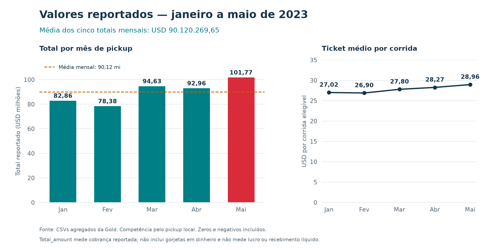
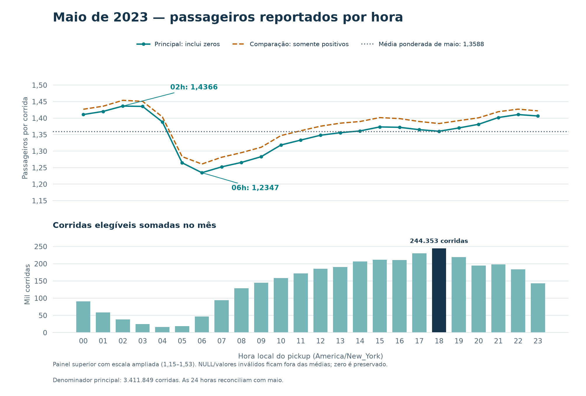
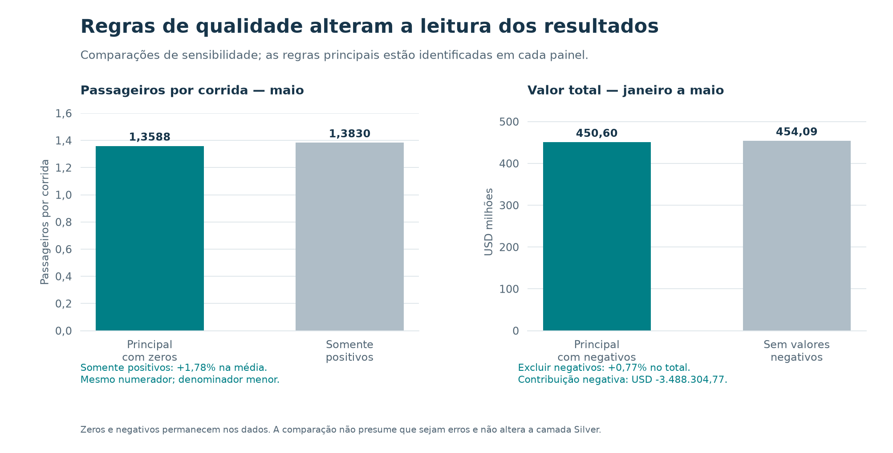

# Resultados — Yellow Taxi, janeiro a maio de 2023

## Valor total e ticket médio

A média dos cinco totais mensais é **USD 90.120.269,65**. O total do período é **USD 450.601.348,23** e o ticket global ponderado é **USD 27,84**.

| Mês de pickup | Corridas elegíveis | Total reportado (USD) | Ticket médio (USD) |
|---|---:|---:|---:|
| 2023-01-01 | 3.066.726 | 82.863.594,11 | 27,02 |
| 2023-02-01 | 2.914.003 | 78.381.600,43 | 26,90 |
| 2023-03-01 | 3.403.660 | 94.634.027,66 | 27,80 |
| 2023-04-01 | 3.288.248 | 92.956.843,11 | 28,27 |
| 2023-05-01 | 3.513.645 | 101.765.282,92 | 28,96 |

A média dos totais divide a soma dos cinco totais por cinco. O ticket divide o valor pela quantidade de corridas elegíveis; o ticket global não é a média simples dos tickets mensais. As duas interpretações da primeira pergunta estão disponíveis nos CSVs.

## Passageiros por hora em maio

| Hora local | Corridas elegíveis | Média com zeros | Média somente positivos |
|---|---:|---:|---:|
| 00h | 90.799 | 1,4109 | 1,4269 |
| 01h | 59.037 | 1,4204 | 1,4362 |
| 02h | 38.072 | 1,4366 | 1,4541 |
| 03h | 24.833 | 1,4356 | 1,4509 |
| 04h | 16.307 | 1,3887 | 1,4039 |
| 05h | 18.754 | 1,2647 | 1,2834 |
| 06h | 46.866 | 1,2347 | 1,2610 |
| 07h | 94.473 | 1,2524 | 1,2815 |
| 08h | 129.158 | 1,2658 | 1,2954 |
| 09h | 144.965 | 1,2832 | 1,3118 |
| 10h | 158.104 | 1,3186 | 1,3472 |
| 11h | 172.196 | 1,3335 | 1,3618 |
| 12h | 185.624 | 1,3482 | 1,3756 |
| 13h | 190.155 | 1,3559 | 1,3848 |
| 14h | 206.767 | 1,3612 | 1,3898 |
| 15h | 211.184 | 1,3734 | 1,4016 |
| 16h | 211.034 | 1,3722 | 1,3986 |
| 17h | 230.221 | 1,3650 | 1,3898 |
| 18h | 244.353 | 1,3603 | 1,3837 |
| 19h | 219.288 | 1,3703 | 1,3924 |
| 20h | 194.564 | 1,3814 | 1,4010 |
| 21h | 198.448 | 1,4019 | 1,4195 |
| 22h | 183.432 | 1,4109 | 1,4273 |
| 23h | 143.215 | 1,4065 | 1,4221 |

A média ponderada do mês é **1,3588**: 4.636.023 passageiros reportados / 3.411.849 corridas elegíveis. Não é a média simples das 24 médias. O maior valor ocorre às 02h e o menor às 06h. O maior volume elegível ocorre às 18h, com 244.353 corridas somadas no mês.

## Qualidade, sensibilidade e interpretação

- Maio tem o maior total e ticket do recorte; seu total é 22,81% superior ao de janeiro. A comparação não comprova causa nem sazonalidade anual.
- A média inclui zeros reportados e ignora passageiros NULL ou inválidos. Somente positivos resulta em 1,3830, aumento de 1,78%. Nulo não é imputado como zero.
- Valores monetários negativos permanecem na resposta principal; removê-los aumentaria o total em USD 3.488.304,77 (0,77%). Não se presume que sejam erros.
- A média descreve os valores conhecidos reportados por corrida, sem provar ocupação real sem viés. VendorID identifica provedor, não táxi. Total_amount é cobrança reportada, não lucro nem recebimento líquido confirmado.
- A competência usa pickup local nos cinco arquivos solicitados. Eventos fora da janela permanecem armazenados e não entram nas métricas do período; arquivos adjacentes não completam as fronteiras.

[Exploração de janeiro](eda_janeiro.md) · [Arquitetura, regras e execução](../README.md).
